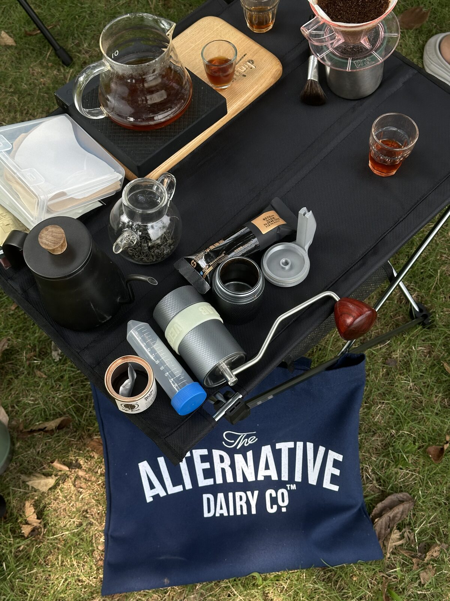

One morning in mid-October I packed a Kono Meimon dripper and a kettle and went to the Swan Lake park in Ecopark, just outside Hanoi. There was a little sun, but the wind off the water was cold, and hardly anyone was around.

I set up by the lake and poured a pot of coffee with no plan and no recipe in mind. The cold air, the wind, and the smell of hot coffee I had made with my own hands, all at once. It was properly chill.

Standing there with the cup, I kept thinking about the days when making coffee was my job.

---

## Two years behind the bar

I worked as a barista for two years. My days were 11 hours long, and I went home tired, but I was happy.

It was my first real step out into the world, and I was new at almost everything. A lot of what I did there, I was doing for the first time. Some of it I used to think I could never do at all. That is what I remember most from those years, more than the long shifts.

Along the way I got to brew with almost everything: a syphon, the Kono, Kalita, Hario V60, Hario Switch, the Blue Bottle dripper, the SOLO by Mazelab, cold drip, cold brew, the Vietnamese phin, and a Flair for espresso by hand.

---

## The job ended, the coffee didn't

I left the bar to follow another path I love: tech, first as a software engineer and now moving into AI engineering.

Coffee came with me. It is a hobby now, not a profession, and I still want to get more out of it: more brews, more places, more mornings like that one by the lake.

So this is the first of more posts about coffee. The cups, the places, and the parts of my life that have passed through them.
